## `~/about` 

**ਸਤਿ ਸ੍ਰੀ ਅਕਾਲ — I'm Harvi.** I build the whole thing: the schema, the API, the UI, and lately the voice on the other end of the phone.

- `▸ now` &nbsp;building **Kasepod**, an immigration CRM whose AI receptionist *Maya* picks up the phone
- `▸ side` &nbsp;**[Friday](https://github.com/WhyHarvi/Friday)**, a desktop AI command center with memory, voice and vision
- `▸ soul` &nbsp;**[NitVaak](https://github.com/WhyHarvi/NitVaak)**, a local-first Gurbani reader for iOS
- `▸ loves` &nbsp;voice-AI latency, clean data models, interfaces that feel calm
- `▸ motto` &nbsp;*ship it, then make it beautiful*

 

## `~/projects`

  
  

## `~/stack`

  

## `~/activity`

  
  

  

